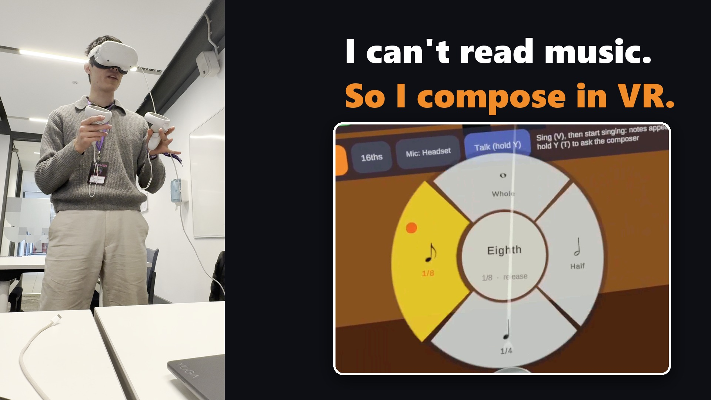

# VR Composer

Write music in virtual reality, even if you have never read a sheet of music.
Built for Meta Quest 2 at DurHack 2026.

Click the image to watch the demo video (1:30).

## What it does

You stand in front of a music stave in VR. You pick notes, place them on the stave, and press Play.
An orchestra in the room plays back what you wrote, in a concert hall, a recital room, a jazz club
or a cathedral.

## How you use it

- **Pick a note with your wrist.** Hold X and a wheel of note lengths appears. Twist your wrist
  like turning a dial to choose one, then let go. Hold A to do the same for instruments.
- **Place it on the stave.** Point at the stave and pull the trigger. You can also drag notes from
  the palette, and drag a note off the stave to delete it.
- **Press Play.** The musicians in the room play your score.
- **Sing it.** Press Sing and sing a melody. It is turned into notes on the stave.
- **Ask for help.** Hold Y and talk to the AI composer, for example "add a piano part". It edits
  the score for you.

## Two modes

**Beginner.** Notes snap to a five-note scale, so nothing sounds wrong. A Motifs tab has ready-made
one-bar phrases, and a Chords tab has chord blocks for a backing band. Tiles marked Suggested fit
the next empty bar. You still decide where everything goes.

**Advanced.** Full notation: whole notes to sixteenths, dots, rests, sharps and flats, dynamics,
and up to four instruments.

## How it is built

- Unity 6, OpenXR and the XR Interaction Toolkit, running on Quest 2 through Quest Link.
- Audio is a real-time SoundFont synthesizer (MeltySynth) running on the audio thread, so every
  note plays exactly as written.
- The note wheel reads only the twist of the controller around its own axis, so moving your arm
  does not change the selection.
- The AI composer uses an ElevenLabs voice agent that can read and edit the score.
- Singing is turned into notes by tracking the pitch of your voice.

## Run it

1. Open the project in Unity 6 and open `Assets/Scenes/SampleScene`.
2. Run **Tools > VR Composer > Add To Open Scene**, then save the scene.
3. Connect a Quest 2 with Quest Link and press Play. Without a headset it switches to mouse and
   keyboard after a few seconds.

More detail is in `Assets/VRComposer/README.md`.
